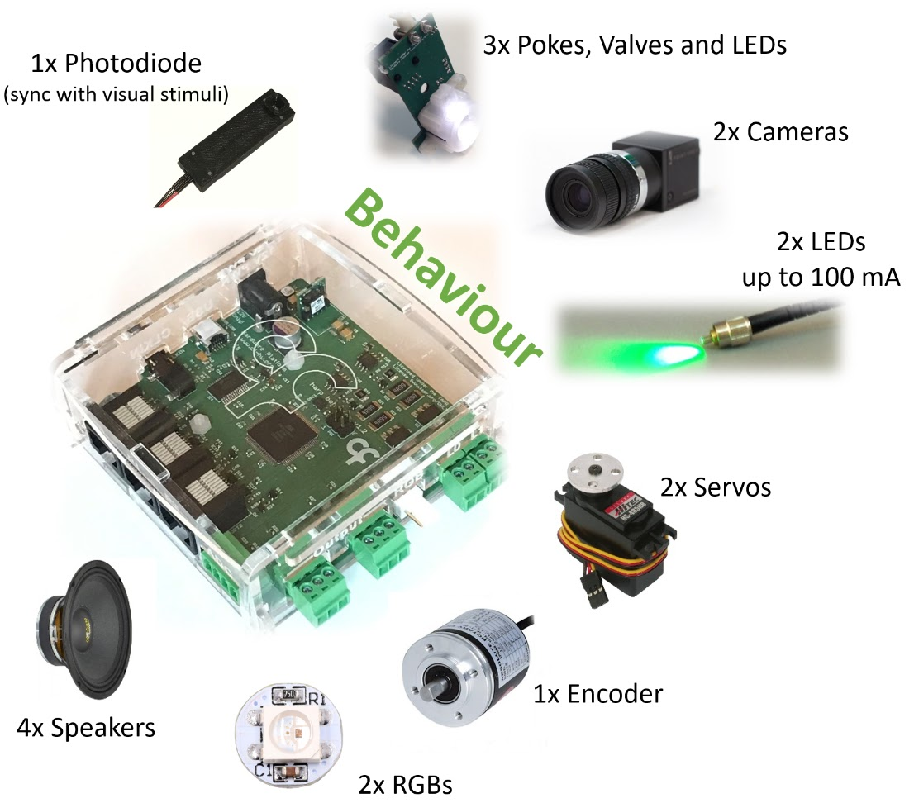

# Harp

::::: landing

:::: landing-text
Harp is a standard for asynchronous real-time data acquisition and experimental control in neuroscience. Each device timestamps every event in hardware and synchronizes to a shared clock, so data from a whole setup is aligned without any processing afterwards. The Harp standard covers a lightweight binary communication protocol, a set of common registers for microcontroller firmware, and a clock synchronization protocol.

::: landing-detail
Commands and events are streamed to the host computer over USB with a latency of one millisecond. The stateless and symmetric communication protocol allows temporally accurate logging without fixed sampling rates or redundant processing, and devices connected to the shared clock line keep their clocks synchronized to a precision of tens of microseconds.
:::

<a class="landing-card" href="use/devices.md">
<i class="bi bi-box-seam"></i> Use
Find a device and control it from Bonsai or Python.
</a>
<a class="landing-card" href="build/toolkit.md">
<i class="bi bi-tools"></i> Build
Generate, verify and update devices with the Harp Toolkit.
</a>
<a class="landing-card" href="connect/index.md">
<i class="bi bi-share"></i> Connect
Ask questions and share projects with the community.
</a>

::::

:::: landing-image

::::

:::::
